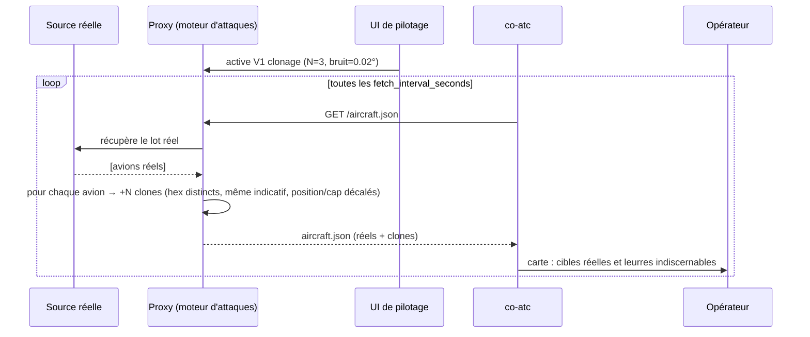

# Architecture du banc d'essai — Proxy d'attaque ADS-B

Document d'architecture du banc d'essai ADS-B. Décisions de référence : [ADR-0002](adr/0002-type-de-banc-hybride.md) (hybride), [ADR-0003](adr/0003-injection-faux-recepteur-http.md), [ADR-0007](adr/0007-proxy-intermediaire-python.md) (proxy mono-source).

Schémas éditables : [`docs/diagrams/`](diagrams/) (format draw.io / diagrams.net).

---

## 1. Constat : co-atc est mono-source

`internal/adsb/client.go` → `fetchBySource()` sélectionne **une seule** source via `source_type`. Il n'existe aucun chemin d'ingestion simultanée de deux flux. Conséquence : on ne peut pas « ajouter » notre application comme source secondaire. On **interpose** donc un proxy.

| Mode `source_type` | Endpoints requis | Intérêt pour nous |
|---|---|---|
| `tar1090` | `aircraft.json` + `receiver.json` + `stats.json` | Réaliste, mais 3 fichiers à servir |
| **`readsb-api`** | **une seule URL** (`aircraft.json`) | **Retenu** — point d'intégration le plus simple |
| `readsb-file` | fichiers locaux | Secours hors-ligne |
| `external-opensky` | API OpenSky | Source **amont** réelle à relayer |

---

## 2. Architecture nominale (avant attaque)

Flux normal de co-atc, pour référence. Schéma : [`diagrams/01-co-atc-nominal.drawio`](diagrams/01-co-atc-nominal.drawio).

```
┌────────────────┐   HTTP/poll   ┌──────────────────────────────────────────┐   WebSocket   ┌───────────┐
│ Source ADS-B   │ ────────────▶ │ co-atc                                    │ ────────────▶ │ Opérateur │
│ réelle         │  aircraft.json│  ingestion → détection conflits/phases →  │               │ (carte)   │
│ (OpenSky/…)    │               │  change detector → broadcast              │               │           │
└────────────────┘               └──────────────────────────────────────────┘               └───────────┘
```

---

## 3. Architecture du banc d'essai (avec proxy d'attaque)

Schéma : [`diagrams/02-architecture-proxy-attaque.drawio`](diagrams/02-architecture-proxy-attaque.drawio).

```
                        ┌─────────────────── APPLICATION D'ATTAQUE (Python) ───────────────────┐
┌──────────────┐  pull  │  ┌──────────┐   ┌─────────────────────┐   ┌───────────────────────┐  │  serve   ┌──────────────────┐
│ Source ADS-B │ ─────▶ │  │ Fetcher  │─▶ │ Moteur d'attaques   │─▶ │ Serveur aircraft.json │  │ ───────▶ │ co-atc           │
│ réelle OU    │        │  │ (amont)  │   │ V1 clone · V2 traj. │   │ (endpoint readsb-api) │  │  poll    │ source_type=     │
│ rejeu .db    │        │  └──────────┘   │ V3 squawk · V4 flood│   └───────────────────────┘  │          │  readsb-api      │
└──────────────┘        │                 └──────────▲──────────┘                               │          └───────┬──────────┘
                        │                            │ config live                             │                  │ WebSocket
                        │                 ┌──────────┴──────────┐                               │                  ▼
                        │                 │ UI web de pilotage  │  ◀── opérateur-attaquant      │           ┌──────────────┐
                        │                 │ (toggles + params)  │                               │           │ Carte /      │
                        │                 └─────────────────────┘                               │           │ détecteur D1/D2│
                        └──────────────────────────────────────────────────────────────────────┘           └──────────────┘
```

**Principe :** l'application interroge la source réelle à chaque cycle, transforme le lot de cibles selon les attaques actives, puis sert le résultat à co-atc, qui l'ingère comme s'il venait d'un récepteur `readsb`. **co-atc n'est pas modifié.**

### Composants de l'application Python

| Composant | Rôle |
|---|---|
| **Fetcher amont** | Récupère le flux réel (OpenSky anonyme / tar1090) ou rejoue une base `data/*.db`. Normalise au format `ADSBTarget`. |
| **Moteur d'attaques** | Chaîne de transformations activables : V1 clonage, V2 dérive de trajectoire, V3 injection de squawk, V4 flooding. Paramétrable (facteur N, bruit…). |
| **Serveur de sortie** | Expose `GET /aircraft.json` au format dump1090, interrogé par co-atc. |
| **UI web de pilotage** | Page web : activer/désactiver chaque attaque, régler les paramètres, voir l'état, en direct pendant la démo. |
| **État partagé** | Configuration des attaques en mémoire, modifiée par l'UI et lue par le moteur à chaque cycle. |

Pile suggérée : **FastAPI** (endpoint + UI + API de contrôle dans un seul service) ou Flask. Aucune dépendance à co-atc.

### Changement de configuration co-atc (une ligne)

```toml
[adsb]
source_type = "readsb-api"
readsb_api_url = "http://127.0.0.1:9900/aircraft.json"   # endpoint du proxy d'attaque
```

---

## 4. Flux de données d'un cycle d'attaque (clonage V1)

Vue séquence ci-dessous (Mermaid) ; vue transformation : [`diagrams/03-transformation-clonage.drawio`](diagrams/03-transformation-clonage.drawio).



---

## 5. Isolement et sécurité du banc

- Tout en **localhost** / réseau de labo ; **aucune émission RF** ([ADR-0004](adr/0004-contrainte-ethique-pas-de-rf.md)).
- La source amont peut être un **rejeu hors-ligne** d'une base `data/*.db` : démo entièrement reproductible, sans dépendre d'Internet ni d'un vrai récepteur.
- Le proxy ne réécrit que des données ; il n'envoie rien vers la source amont réelle.

---

## 6. À décider ensuite (futurs ADR)

- **ADR-0012** — paramètres d'expérimentation (N, amplitude de bruit, cadence) et métriques.
- **ADR-0013** — intégration du détecteur de défense (D1/D2) : module séparé vs lecture du flux co-atc.

> Déjà pris : ADR-0008 (conformité), ADR-0009 (contrat `aircraft.json`), ADR-0010 (sources amont du proxy), ADR-0011 (vérité terrain).
